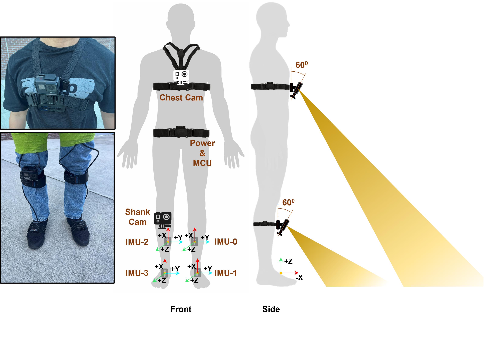
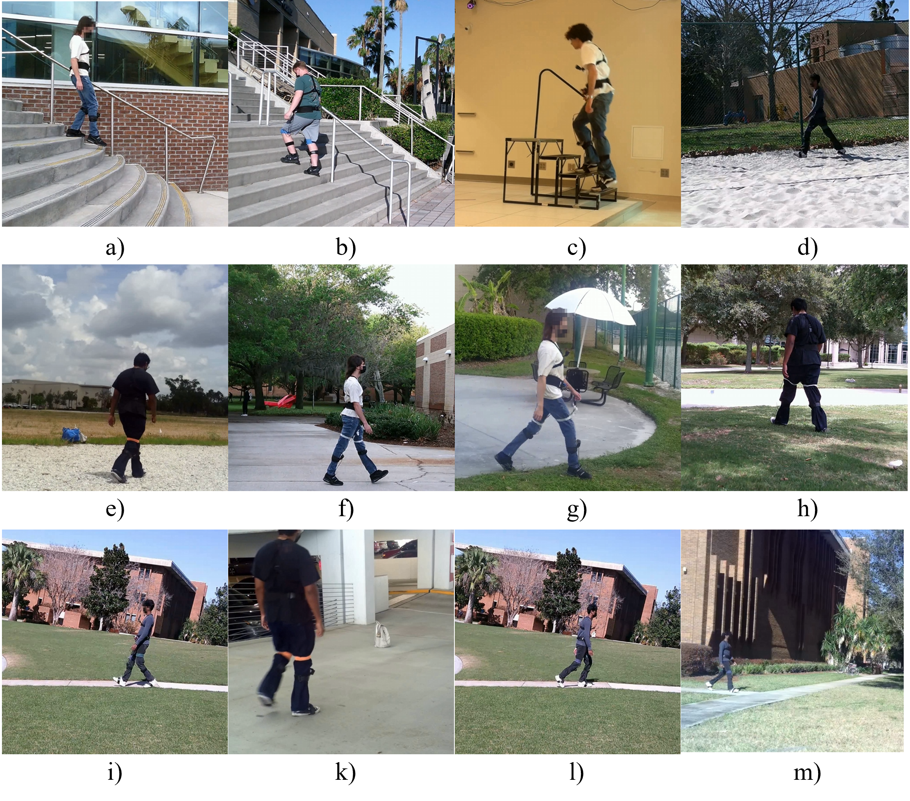
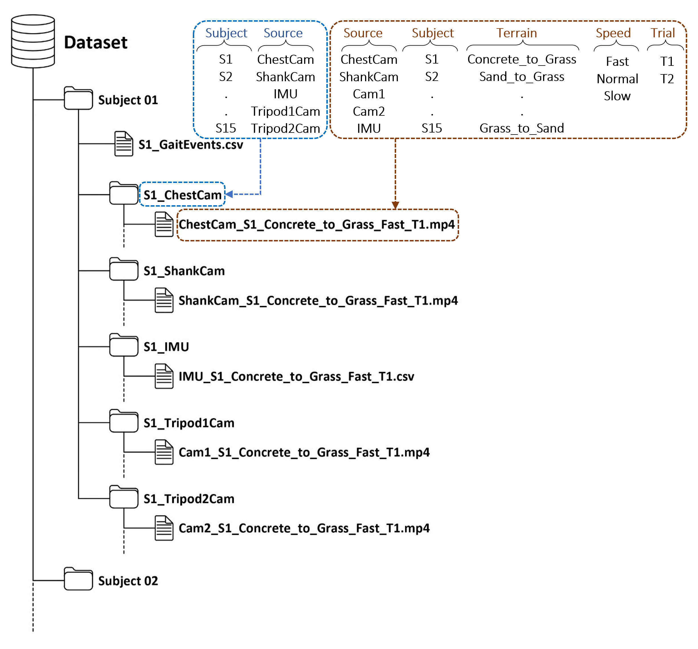

# GMT-15: A Multimodal IMU and Wearable Video Dataset for Human Locomotion Across Terrains and Speeds

This repository contains processing, synchronization, and baseline benchmark code associated with **GMT-15**, a multimodal locomotion dataset collected from 15 healthy adults across structured and natural walking environments.

The dataset combines:

- **4 wearable IMUs** mounted on the bilateral shanks and feet
- **2 wearable GoPro HERO7 Black cameras** mounted on the chest and right shank
- **Third-person tripod video**
- **16 locomotion conditions**
- **3 self-selected walking-speed levels**: slow, preferred, and fast
- **Terrain-transition annotations**
- **Synchronized IMU-video timestamps**
- **Participant-independent benchmark evaluation**

> **Dataset DOI:** [Figshare DOI — add when available]  
> **Article DOI:** [Scientific Data DOI — add after publication]

---

## Overview

GMT-15 was developed to support research on terrain-aware human locomotion using synchronized proprioceptive and exteroceptive sensing.

The dataset includes locomotion across stairs, level concrete, grass, sand, gravel, concrete slopes, grass slopes, single terrain transitions, and multi-terrain transitions.

Potential applications include terrain and locomotion-mode classification, terrain-transition detection and timing, gait-event and gait-phase recognition, multimodal IMU-video learning, wearable robotics, adaptive prosthetic and exoskeleton control, subject-independent locomotion recognition, domain adaptation and generalization, markerless gait and pose analysis, and human-to-robot motion learning.

---

## Dataset sensing configuration

Each participant wore four IMUs:

| Sensor index | Location |
|---|---|
| IMU 0 | Left shank |
| IMU 1 | Left foot |
| IMU 2 | Right shank |
| IMU 3 | Right foot |

The IMUs were sampled at a nominal frequency of **100 Hz**.

Two wearable GoPro HERO7 Black cameras recorded video at **30 frames/s**:

- chest-mounted camera
- right-shank-mounted camera

Stationary tripod cameras were additionally used to provide third-person views of the experiments.

---

## Locomotion conditions

The dataset contains the following 16 locomotion conditions:

1. `StairAscent`
2. `StairDescent`
3. `Concrete`
4. `ConcreteToGrass`
5. `GrassToConcrete`
6. `ConcreteSlopeAscent`
7. `ConcreteSlopeDescent`
8. `GrassSlopeAscent`
9. `GrassSlopeDescent`
10. `ConcreteToSand`
11. `SandToConcrete`
12. `GrassToSand`
13. `Sand`
14. `Gravel`
15. `SandToGrassToConcrete`
16. `ConcreteToGrassToSand`

Participant availability varies by condition. Refer to the dataset manuscript and metadata for the exact subject-condition mapping.

---

## Repository structure

```text
Multimodal_locomotion_dataset/
│
├── README.md
├── LICENSE
├── requirements.txt
├── .gitignore
│
├── synchronization/
│   └── align_imu_video.py
│
├── benchmark/
│   ├── model.py
│   ├── train.py
│   ├── evaluate.py
│   └── loso_splits.py
│
├── figures/
│   ├── sensor_setup.png
│   ├── terrain_examples.png
│   └── dataset_structure.png
│
└── docs/
    └── file_naming.md
```

---

## Dataset organization

The full dataset is hosted on Figshare rather than GitHub.

The Figshare release is organized into 15 subject-specific archives. For example:

```text
Subject 01/
├── S1_ChestCam/
├── S1_IMU/
├── S1_ShankCam/
├── S1_Tripod1Cam/
├── S1_Tripod2Cam/
└── S1_GaitEvents.csv
```

The same structure is used for Subjects 01–15.

---

## File naming convention

Files follow the general naming convention:

```text
Source_Subject_Terrain_Speed_Trial
```

Example:

```text
ChestCam_S1_Concrete_to_DownStair_to_Concrete_Fast_T1.mp4
ShankCam_S1_Concrete_to_DownStair_to_Concrete_Fast_T1.mp4
Cam1_S1_Concrete_to_DownStair_to_Concrete_Fast_T1.mp4
Cam2_S1_Concrete_to_DownStair_to_Concrete_Fast_T1.mp4
IMU_S1_Concrete_to_DownStair_to_Concrete_Fast_T1.csv
```

Recordings from different modalities can therefore be matched using the common subject, terrain, speed, and trial identifiers.

---

## IMU file format

Each IMU CSV contains measurements from all four IMUs:

```text
t_us, seq,
ax0, ay0, az0, gx0, gy0, gz0,
ax1, ay1, az1, gx1, gy1, gz1,
ax2, ay2, az2, gx2, gy2, gz2,
ax3, ay3, az3, gx3, gy3, gz3,
video_sec
```

Where:

- `t_us` = IMU timestamp in microseconds
- `seq` = sample sequence index
- `ax`, `ay`, `az` = tri-axial acceleration
- `gx`, `gy`, `gz` = tri-axial angular velocity
- `video_sec` = synchronized video timestamp in seconds

Because occasional samples may be skipped during acquisition, downstream code should use recorded timestamps rather than assuming an exact 0.01-s interval between every sample.

---

## Gait-event and transition annotations

Each subject includes a gait-event/transition annotation file containing information such as:

- associated IMU filename
- number of steps
- starting foot
- ending foot
- first terrain-transition time
- second terrain-transition time, when applicable

For single-transition trials, the second transition field is not applicable.

Transition timestamps are derived from synchronized video and mapped to the nearest IMU `video_sec` timestamp.

---

## Multimodal synchronization

The synchronization pipeline aligns wearable IMU and video recordings using manually identified common gait events.

The processing workflow includes:

1. synchronization of available video perspectives
2. segmentation of continuous recordings into individual trials
3. annotation of a common gait event in video and IMU data
4. calculation of the temporal offset between modalities
5. propagation of the aligned video time across the complete IMU trial

The resulting IMU files include a `video_sec` value for each IMU sample, allowing direct temporal association with synchronized video.


## Baseline benchmark

A baseline multi-task model was developed for:

1. terrain classification
2. terrain-transition detection
3. transition-timing estimation

Three sensing configurations were evaluated:

- two IMUs
- one IMU + right-shank camera
- one IMU + chest camera

Each IMU input window contains **200 samples** of tri-axial acceleration and angular velocity. Camera-based configurations additionally use synchronized RGB frames from the same time interval.

IMU sequences are encoded using a bidirectional LSTM (BiLSTM), while camera-based models use a lightweight 3D CNN for spatiotemporal visual feature extraction. The learned IMU and video representations are fused before predicting terrain class, transition presence, and transition timing.

Evaluation uses **leave-one-subject-out (LOSO) cross-validation**.

### Reported baseline results

| Configuration | Terrain accuracy | Presence F1 | Timing MAE |
|---|---:|---:|---:|
| Two IMUs | 51.18% | 31.19% | 1.45 s |
| IMU + shank camera | 82.53% | 78.70% | 0.48 s |
| IMU + chest camera | 84.56% | 67.38% | 0.52 s |

The chest-camera configuration produced the highest terrain-recognition accuracy, while the shank-camera configuration performed best for transition detection and timing.

### Benchmark code

Place the benchmark implementation in:

```text
benchmark/
```

Recommended workflow:

```bash
python benchmark/train.py
python benchmark/evaluate.py
```

Update these commands after finalizing the actual training scripts and command-line arguments.

---

## Example usage

An example loader should demonstrate how to:

1. load one IMU CSV
2. identify the corresponding video files
3. access synchronized `video_sec`
4. load transition annotations
5. visualize IMU signals around a terrain transition

Place this example in:

```text
examples/example_load_trial.py
```

---

## Installation

Create a Python environment and install dependencies:

```bash
pip install -r requirements.txt
```

A typical `requirements.txt` may include:

```text
numpy
pandas
scipy
matplotlib
opencv-python
torch
scikit-learn
tqdm
```

Only include packages actually required by the released scripts.

---

## Figures

Repository figures can be displayed directly in this README.

## Wearable sensor configuration

<p align="center">
  
</p>

## Representative terrain environments

<p align="center">
  
</p>

## Dataset organization

<p align="center">
  
</p>

---

<p align="center">
  
</p>

<p align="center">
  <em>
  Wearable sensing configuration with four bilateral lower-limb IMUs
  and chest- and right-shank-mounted cameras.
  </em>
</p>

## Representative experimental environments

<p align="center">
  
</p>

<p align="center">
  <em>
  Representative structured and natural terrains included in GMT-15,
  including stairs, concrete, grass, sand, gravel, slopes, and terrain transitions.
  </em>
</p>

## Dataset organization

<p align="center">
  
</p>

<p align="center">
  <em>
  Subject-level directory structure and multimodal file-naming convention.
  </em>
</p>


## Reproducibility

Before releasing the code, ensure that:

- participant-independent LOSO splits are reproducible
- random seeds are fixed where appropriate
- preprocessing is performed independently within each training fold
- all paths are relative rather than hard-coded to a local computer
- example scripts run from a clean environment
- package versions are recorded in `requirements.txt`
- transition annotations and sensor mappings match the released Figshare data

---

## Privacy

Do not place identifiable participant data in this GitHub repository.

The public dataset should contain only data approved for release under the study protocol. Released videos should follow the privacy-processing procedures described in the dataset documentation, including removal or obscuration of identifying information where applicable.

---

## Citation

If you use GMT-15, please cite the associated dataset article:

```text
Sy Nguyen, Jason Medrano, Nathan Mitchell, Jamalia Sultana,
Zhaozheng Yin, and Hwan Choi,
"GMT-15: A Multimodal IMU and Wearable Video Dataset for Human
Locomotion Across Terrains and Speeds,"
Scientific Data, [year].
```

The final citation and DOI will be added after publication.

---

## Authors

- **Sy Nguyen** — University of Central Florida
- **Jason Medrano** — University of Central Florida
- **Nathan Mitchell** — University of Central Florida
- **Jamalia Sultana** — Stony Brook University
- **Zhaozheng Yin** — Stony Brook University
- **Hwan Choi** — University of Central Florida


---

## License

**Code license:** [Choose license, e.g. MIT or BSD-3-Clause]

The dataset license is defined separately in the Figshare release.

---

## Contact

For questions regarding the dataset, please contact:

**SY NGUYEN**  
Department of Mechanical and Aerospace Engineering  
University of Central Florida  
Email: sy.nguyen@ucf.edu
Email: nguyenvansy240@gmail.com
